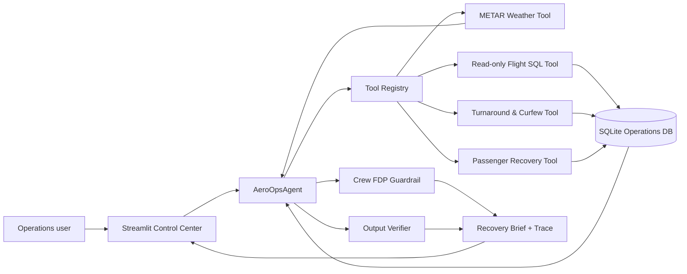
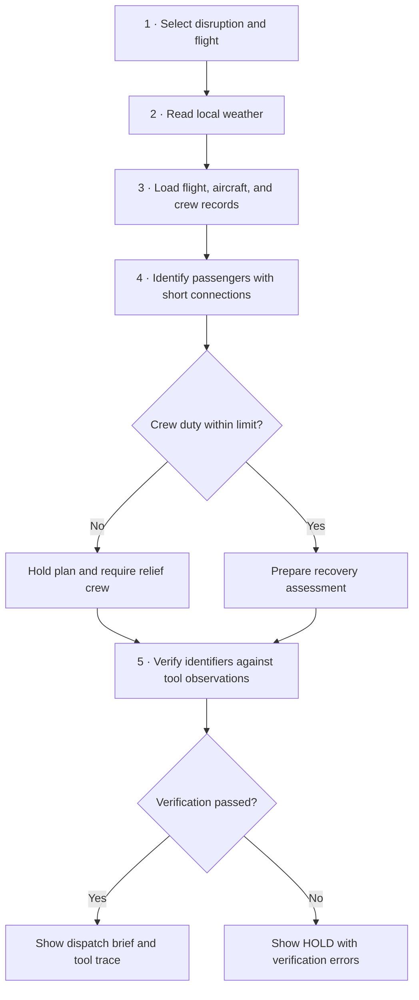

<div align="center">

# ✈️ AeroOps

### Autonomous Aviation Disruption Management & Dispatch Recovery Copilot

**A local-first aviation disruption recovery copilot that combines synthetic flight and weather data with operational tools, crew-duty guardrails, passenger-connection risk checks, and a dispatch-ready recovery brief.**

<br>


</div>

---

## What is AeroOps?

AeroOps is a local prototype for airline **Irregular Operations (IROPS)** decision support. It brings operational data and recovery checks into one workflow: inspect the affected flight, assess hub weather, find passengers at risk of missing connections, enforce crew duty limits, and present a traceable dispatch brief.

The project is designed to be easy to run on a laptop. It uses SQLite and synthetic example data; it does not require an airline system or a model API key to launch the demo.

> **Project description (215 characters):** A local-first aviation disruption recovery copilot that combines synthetic flight and weather data with operational tools, crew-duty guardrails, passenger-connection risk checks, and a dispatch-ready recovery brief.

## At a glance

| Area | What it does |
| --- | --- |
| Operations data | Stores sample airports, aircraft, flights, crew rosters, and passengers in SQLite. |
| Weather | Decodes supported METAR groups, including wind, gusts, visibility, ceiling, flight category, thunderstorms, and runway crosswind estimate. |
| Flight lookup | Runs validated read-only SQL against the local operations database. |
| Passenger recovery | Flags connections below the configured minimum and returns candidate onward flights, with higher-tier passengers listed first. |
| Safety checks | Enforces crew duty limits and provides an aircraft-turn and airport-curfew feasibility tool. |
| Recovery workflow | Records tool calls, observations, latency, errors, retries, and a final output verification result. |
| Operations UI | Shows sample operation counts, launches three disruption scenarios, and displays the reasoning trace and brief. |

## Architecture



### Recovery pipeline



## How a run works

1. Choose a disruption scenario and flight in the sidebar.
2. The agent requests the local DXB METAR sample and reads the selected flight and aircraft from SQLite.
3. The passenger tool reports short connections and candidate onward flights.
4. Crew roster duty is checked against the recorded maximum. If the proposed delay exceeds the limit, the brief calls for relief crew.
5. The output verifier checks flight numbers, tail numbers, and gate references against the tool observations.
6. The UI shows the brief, observations, tool parameters, and any safety or self-correction alert.

The workflow records operational facts separately from the scenario's planning-delay assumption. A generated brief is a decision-support artifact, not a dispatch release.

## Disruption scenarios

The Streamlit sidebar includes three demo scenarios:

- **A · Severe thunderstorm at DXB:** Uses the local OMDB sample METAR with thunderstorm, gust, and visibility groups.
- **B · Hydraulic snag on EK001:** Demonstrates an aircraft-disruption scenario label and allows a recovery assessment for the selected flight. The current prototype does not automatically select or execute a tail swap.
- **C · Crew duty timeout:** Uses a four-hour planning-delay assumption to exercise the crew FDP guardrail and relief-crew alert.

Scenario data are repeatable synthetic records, not live operational events.

## Tools and guardrails

| Component | Purpose | Current boundary |
| --- | --- | --- |
| `METARWeatherTool` | Resolves supported ICAO/IATA codes and parses sample or supplied METAR strings. | Crosswind uses the requested runway heading, defaulting to 340°. It does not fetch live weather or runway configuration. |
| `FlightSQLTool` | Provides schema context and accepts single read-only `SELECT` queries. | Operates only on the local SQLite database. |
| `TurnaroundFeasibilityTool` | Compares available turn time with the aircraft minimum and checks the destination curfew window. | Available through the registry; the default UI workflow does not yet call it automatically. |
| `PassengerRebookingTool` | Finds sub-MCT connections and candidate onward services, ordered by tier. | Reports candidates only; it does not book or change reservations. |
| `AviationSafetyGuard` | Rejects crew duty overruns and aircraft turns below the configured minimum. | The default agent workflow currently applies the crew check; invoke the turnaround tool for a turn assessment. |
| `OutputVerifier` | Checks flight, tail, and gate identifiers named in a brief against observed data. | Does not independently certify every schedule statement or legal conclusion. |
| `SelfHealingEngine` | Retries failed tool calls up to the configured retry limit and corrects common code/schema mistakes. | This is bounded parameter repair, not an unrestricted model-debugging loop. |

Passenger compensation is intentionally conservative. The tool can return an indicative EU261 amount only when eligibility is explicitly supplied; legal entitlement, route distance, cause, and applicable exceptions require a separate authorized review.

## Repository map

```text
aero_ops/
├── agent/       Agent workflow, state, prompts, LLM client, and retry engine
├── config/      Typed settings and operational defaults
├── database/    SQLite schema, connection pool, and synthetic seed data
├── guardrails/  Crew duty, turnaround, and output verification checks
├── tests/       Tool, guardrail, and self-healing tests
├── tools/       METAR, read-only SQL, turnaround, and passenger tools
└── ui/          Streamlit operations control center
```

## Data model

The SQLite schema contains five related operational entities:

- **Airports:** ICAO/IATA codes, location, timezone, and optional curfew window.
- **Aircraft:** tail number, model, capacity, operational status, and minimum turnaround.
- **Flights:** route, aircraft, scheduled/actual timestamps, status, gate, and delay minutes.
- **Crew rosters:** crew member, assigned flight and role, duty start, and maximum duty hours.
- **Passengers:** booking reference, tier, connecting flight, and connection time.

The repeatable seeder creates at least 32 flights and synthetic operations around DXB/OMDB, LHR/EGLL, JFK/KJFK, and SIN/WSSS. It includes example delayed flights and connection risks.

## Quick start

### Requirements

- Python 3.10 or newer
- Windows PowerShell, macOS, or Linux terminal

### Install and launch

From the repository root:

```powershell
python -m venv .venv
```

Activate the environment and install dependencies:

```powershell
# Windows PowerShell
.\.venv\Scripts\Activate.ps1

# macOS / Linux
# source .venv/bin/activate

python -m pip install -r requirements.txt
```

Seed the local database and start the control center:

```powershell
python -m aero_ops.database.seed_data
streamlit run aero_ops/ui/app.py
```

If Windows has Python installed but `python` is not on `PATH`, call the interpreter by its full path, or add the Python install directory to `PATH`. For example:

```powershell
& "$env:LOCALAPPDATA\Programs\Python\Python311\python.exe" -m pip install -r requirements.txt
& "$env:LOCALAPPDATA\Programs\Python\Python311\python.exe" -m streamlit run aero_ops/ui/app.py
```

### Run tests

```powershell
python -m pytest aero_ops/tests -q
```

The included suite covers METAR parsing, read-only SQL, turnaround calculation, crew duty and minimum-turn guardrails, and SQL self-healing. The current project test run passes **6 tests**.

## Configuration and model providers

Copy `.env.example` to `.env` to set local options. The settings support `MODEL_PROVIDER` values `mock`, `openai`, `anthropic`, and `gemini`, plus provider API keys and a model name. Tool schemas can be exported in OpenAI-, Anthropic-, and Gemini-style function-calling formats.

The provider-neutral text client is implemented in `aero_ops/agent/llm.py`. The current `AeroOpsAgent` recovery path uses deterministic local orchestration and does **not** call that client to choose actions or write the dispatch brief. Configure a live provider only when extending or integrating the model into a reviewed workflow; doing so does not make the sample data live or authorize operational actions.

| Setting | Purpose | Default |
| --- | --- | --- |
| `MODEL_PROVIDER` | Provider adapter selection | `mock` |
| `MODEL_NAME` | Provider model identifier | `gpt-4o-mini` |
| `OPENAI_API_KEY` | OpenAI credential | unset |
| `ANTHROPIC_API_KEY` | Anthropic credential | unset |
| `GOOGLE_API_KEY` | Gemini credential | unset |
| `DATABASE_PATH` | SQLite file location | `aero_ops.db` |
| `MINIMUM_CONNECTION_MINUTES` | Default MCT setting | `60` |
| `STANDARD_MAX_DUTY_HOURS` | Default crew duty limit | `14` |
| `MAX_RETRIES` | Maximum tool retry count | `3` |

## Design principles

- **Ground decisions in tool observations.** The agent reads local records rather than inventing flight details.
- **Keep unsafe actions out of the prototype.** Passenger booking, flight-plan submission, and aircraft dispatch are not implemented.
- **Make checks reviewable.** Tool inputs, outputs, retry events, and final verification status are available in the run state and UI.
- **Fail visibly.** Unverified output is held, while over-limit crew duty is explicitly escalated for relief crew.
- **Keep data local by default.** The demo runs with SQLite and synthetic inputs; no external API key is needed to launch it.

## Limitations and production-readiness

This is a **local prototype**, not a certified airline operations system. It does not connect to live METAR/TAF feeds, airline schedules, maintenance systems, crew tracking, airport slots, reservation inventory, or legal compensation services. Its airports, flights, crew, passenger records, and sample weather are synthetic. The demo's recovery brief must not be used as an operational release.

Before any operational deployment, integrate authenticated and monitored live data, airline-approved manuals and rules, reliable time-zone and curfew handling, live slot and maintenance checks, authorized booking workflows, access control, durable audit records, and independent aviation safety and legal validation. Human dispatch authority remains essential.

## License

No license has been selected for this repository yet. Add a license before redistributing or reusing the project outside its intended environment.
